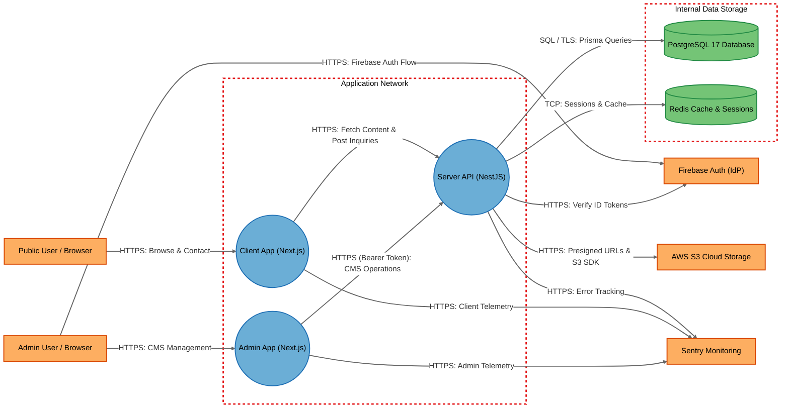
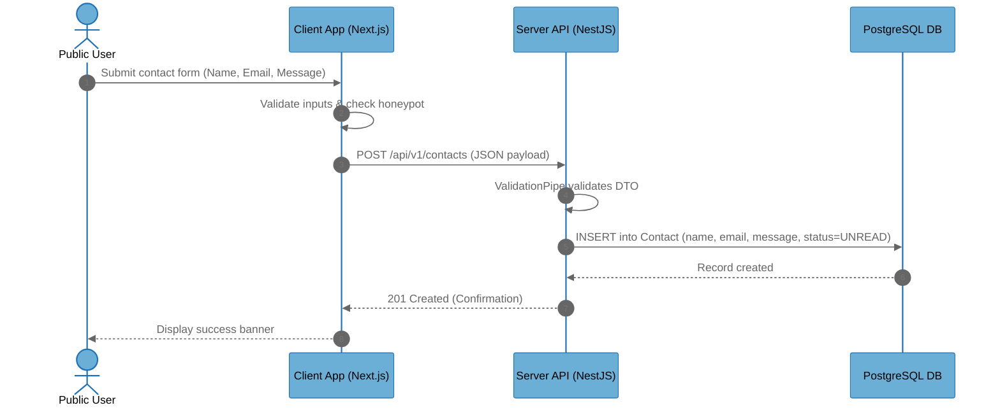
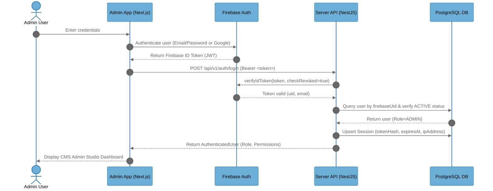
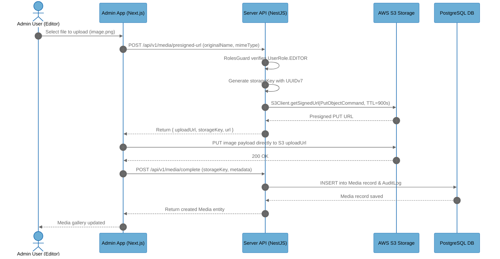

# Architecture Overview

## System Purpose

The Koushik Puppala Monorepo is an integrated digital platform comprising a public personal portfolio website, a private administrative Content Management Studio (CMS), and an authoritative backend REST API. It enables public visitors to explore engineering projects, professional experience, educational background, services, and submit contact inquiries. It provides authenticated administrators with full content authoring, audit logging, asset management, and telemetry workflows.

## Key Components

| Component | Type | Description |
|-----------|------|-------------|
| ClientApp | Process | Next.js 16 public portfolio website serving Server Components, static pages, and visitor inquiry submission |
| AdminApp | Process | Next.js 16 private CMS studio providing content authoring, table filtering, and administrative management interfaces |
| ServerApi | Process | NestJS 11 authoritative REST API gateway managing business logic, authentication, RBAC, and data persistence |
| PostgreSQL | Data Store | PostgreSQL 17 relational database holding modular CMS domain models, sessions, audit logs, and user credentials |
| Redis | Data Store | In-memory key-value cache used for session revocation tracking, API caching, and request rate limiting |
| FirebaseAuth | External Service | Google Firebase Authentication service providing client identity verification and ID token issuance |
| S3Storage | External Service | AWS S3 object store used for media asset storage via server-generated presigned upload and read URLs |
| Sentry | External Service | Cloud application monitoring service collecting error telemetry, stack traces, and performance breadcrumbs |
| PublicUser | External Interactor | Anonymous or public internet user interacting with the public portfolio via web browser |
| AdminUser | External Interactor | Authenticated system operator or editor managing CMS content via web browser |

## Component Diagram

## Top Scenarios

### Scenario 1: Public Contact Inquiry Submission

A public visitor fills out the contact form on the portfolio website. The client application performs local schema validation and forwards the request to the backend REST API, which stores the submission in PostgreSQL and logs an audit record.

### Scenario 2: Administrator Login and Session Issuance

An administrator logs in via the CMS studio using Firebase Authentication credentials. The client receives a Firebase ID token, which is presented to the backend API. The API verifies the token with Firebase Admin SDK, validates that the user exists and is active in PostgreSQL, checks session revocation, records an active session, and returns the user's authoritative database roles.

### Scenario 3: Media Asset Upload via Presigned URL

An authenticated editor requests a presigned upload URL from the backend API. The API verifies the user's role, sanitizes the requested folder and file extension, and uses AWS S3 SDK to generate a temporary presigned PUT URL. The client uploads the asset directly to S3 and then informs the API to register the media metadata in PostgreSQL.

## Technology Stack

| Layer | Technologies |
|-------|--------------|
| Languages | TypeScript 5.8, Node.js 22.x |
| Frameworks | Next.js 16.3.2 (App Router), React 19.2.8, NestJS 11.2.1 (Express adapter), Tailwind CSS v4 |
| Data Stores | PostgreSQL 17 (Prisma 7.9.1 ORM, @prisma/adapter-pg), Redis (ioredis 6.x) |
| Infrastructure | Docker (multi-stage non-root build), GitHub Actions CI/CD, AWS EC2, AWS S3, CloudFront CDN |
| Security | Firebase Admin SDK 14.x, Helmet, Throttler, class-validator, Winston structured logging, Sentry |

## Deployment Model

The monorepo applications are containerized via a multi-stage Docker build and deployed to an AWS EC2 instance. In the target deployment, the Next.js client application listens on port 3000 inside the container and is mapped to host port 3000 or behind an NGINX reverse proxy. The NestJS backend server binds to port 8080/3001 and provides REST endpoints under the `/api/v1` global prefix. PostgreSQL 17 and Redis are hosted within private network boundaries and accessed through environment connection strings (`DATABASE_URL`, `REDIS_HOST`). File uploads communicate with AWS S3 using IAM credentials or AWS SDK presigned URLs.

**Deployment Classification:** `NETWORK_SERVICE`

### Component Exposure Table

| Component | Listens On | Auth Required | Reachability | Min Prerequisite | Derived Tier |
|-----------|------------|---------------|--------------|------------------|-------------|
| ClientApp | 0.0.0.0:3000 | No | External | None | T1 |
| AdminApp | 0.0.0.0:3000 | Yes (Firebase Client SDK) | External | Authenticated User | T2 |
| ServerApi | 0.0.0.0:8080 | Yes (Protected routes) / No (Public routes) | External | None | T1 |
| PostgreSQL | 127.0.0.1:5432 | Yes (Database password) | Internal Only | Internal Network | T2 |
| Redis | 127.0.0.1:6379 | Optional (REDIS_PASSWORD) | Internal Only | Internal Network | T2 |
| FirebaseAuth | N/A — cloud endpoint | Yes (API Key / Admin private key) | External | Authenticated User | T2 |
| S3Storage | N/A — cloud endpoint | Yes (Presigned signature / IAM) | External | Authenticated User | T2 |
| Sentry | N/A — cloud endpoint | Yes (DSN token) | External | None | T1 |
| PublicUser | N/A — no listener | No | No Listener | Host/OS Access | T3 |
| AdminUser | N/A — no listener | Yes (Password / MFA) | No Listener | Host/OS Access | T3 |

## Security Infrastructure Inventory

| Component | Security Role | Configuration | Notes |
|-----------|---------------|---------------|-------|
| FirebaseAuthGuard | Authentication Barrier | Global APP_GUARD in CommonModule | Verifies Firebase ID Bearer token with checkRevoked=true; bypassed only for @Public() routes |
| RolesGuard | Role-Based Access Control | Global APP_GUARD in CommonModule | Inspects request.user.role from PostgreSQL; enforces ADMIN/EDITOR roles |
| ValidationPipe | Input Sanitization & Validation | Global pipe in NestJS main.ts | whitelist: true, forbidNonWhitelisted: true, transform: true |
| Helmet | HTTP Security Headers | Express middleware in main.ts | Sets X-Frame-Options, DNS prefetch, etc.; contentSecurityPolicy disabled |
| ThrottlerGuard | Rate Limiting | Global APP_GUARD in AppModule | In-memory limiter configured for 1000 requests per 60,000ms window |
| LoggerInterceptor | Audit & Diagnostic Logging | Global APP_INTERCEPTOR in CommonModule | Redacts sensitive headers and bodies; logs request duration, status, IP, and user ID |
| GlobalExceptionFilter | Information Leakage Protection | Global APP_FILTER in CommonModule | Redacts 500 error traces and DB errors from clients in production |
| S3Service | Presigned URL Generator | common/storage/s3.service.ts | Generates scoped S3 PUT URLs with strict 900-second TTL and sanitized keys |
| Docker Hardening | Container Security | Dockerfile | Drops root; executes under unprivileged UID 1001 (portfolio:koushikpuppala) |

## Repository Structure

| Directory | Purpose |
|-----------|---------|
| apps/client/ | Public portfolio website (Next.js 16 App Router, React 19, Tailwind CSS v4) |
| apps/admin/ | Private CMS and studio application (Next.js 16, TanStack Table v8, Firebase Client SDK) |
| apps/server/ | Authoritative NestJS REST API backend, services, modules, guards, and controllers |
| packages/prisma/ | PostgreSQL database schema (modular schema/*.prisma), migrations, seed scripts, client |
| packages/ui/ | Shared reusable presentation components (DataTable, Dialog, Table, Tailwind CSS v4) |
| packages/types/ | Shared TypeScript domain contracts, DTOs, and component prop definitions |
| packages/utils/ | Shared utility helper functions (classNames, formatDate, useFormReducer) |
| packages/config/ | Shared TypeScript compiler presets (tsconfig.next.json, tsconfig.nest.json) |
| docs/ | Technical documentation, architecture diagrams, agent engineering workflow |
| .github/workflows/ | GitHub Actions deployment pipelines for production and staging environments |
