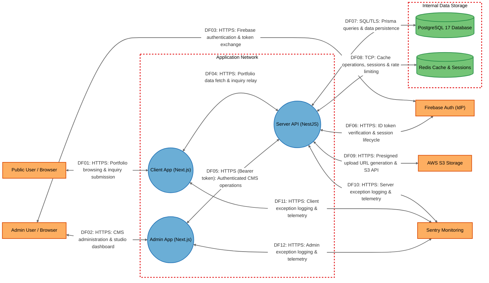

# Threat Model

## Data Flow Diagram

## Element Table

| Element | Type | TMT Category | Description | Trust Boundary |
|---------|------|--------------|-------------|----------------|
| ClientApp | Process | SE.P.TMCore.WebApp | Public-facing Next.js 16 web application rendering portfolio pages and handling visitor form submissions | Application |
| AdminApp | Process | SE.P.TMCore.WebApp | Authenticated Next.js 16 CMS studio interface for managing portfolio content and assets | Application |
| ServerApi | Process | SE.P.TMCore.WebSvc | NestJS 11 authoritative REST API service enforcing authentication, RBAC, and data validation | Application |
| PostgreSQL | Data Store | SE.DS.TMCore.SQL | PostgreSQL 17 relational database storing persistent domain models, audit logs, and sessions | Storage |
| Redis | Data Store | SE.DS.TMCore.Cache | In-memory key-value store for session revocation caching, rate-limit state, and API response caching | Storage |
| FirebaseAuth | External Service | SE.EI.TMCore.AuthProvider | Third-party cloud identity provider managing identity registration and user authentication tokens | Outside Boundary |
| S3Storage | External Service | SE.DS.TMCore.CloudStorage | AWS S3 cloud object store hosting uploaded media assets with presigned access | Outside Boundary |
| Sentry | External Service | SE.EI.TMCore.WebSvc | External cloud monitoring service collecting exception events and application performance traces | Outside Boundary |
| PublicUser | External Interactor | SE.EI.TMCore.User | Anonymous visitor accessing portfolio content and submitting contact inquiries via web browser | Outside Boundary |
| AdminUser | External Interactor | SE.EI.TMCore.User | Content editor or system administrator authenticating to manage the portfolio via CMS studio | Outside Boundary |

## Data Flow Table

| ID | Source | Target | Protocol | Description |
|----|--------|--------|----------|-------------|
| DF01 | PublicUser | ClientApp | HTTPS | Anonymous visitor requests portfolio pages and submits contact inquiries via web browser |
| DF02 | AdminUser | AdminApp | HTTPS | Administrator accesses CMS content management dashboard and editing interfaces |
| DF03 | AdminUser | FirebaseAuth | HTTPS | Administrator authenticates with Firebase Authentication to obtain Firebase ID JWT token |
| DF04 | ClientApp | ServerApi | HTTPS | Next.js Server Components and route handlers fetch public content and forward contact submissions |
| DF05 | AdminApp | ServerApi | HTTPS | Admin studio sends REST requests with Firebase ID Bearer token in Authorization header |
| DF06 | ServerApi | FirebaseAuth | HTTPS | Server verifies Firebase ID tokens and checks revocation status via Firebase Admin SDK |
| DF07 | ServerApi | PostgreSQL | SQL / TLS | NestJS services execute parameterized queries and transactions through Prisma 7 adapter |
| DF08 | ServerApi | Redis | TCP | Server queries session blocklist, caches API responses, and manages rate-limiting counters |
| DF09 | ServerApi | S3Storage | HTTPS | Server issues presigned S3 upload/read URLs and manages object deletions via AWS S3 SDK |
| DF10 | ServerApi | Sentry | HTTPS | NestJS Sentry SDK transmits unhandled exceptions and performance breadcrumbs |
| DF11 | ClientApp | Sentry | HTTPS | Next.js client-side Sentry SDK captures browser rendering errors and uncaught exceptions |
| DF12 | AdminApp | Sentry | HTTPS | CMS studio client-side Sentry SDK captures administrative interface exceptions |

## Trust Boundary Table

| Boundary | Description | Contains |
|----------|-------------|----------|
| Application | Network and container perimeter enclosing Next.js client applications and the NestJS API service | ClientApp, AdminApp, ServerApi |
| Storage | Isolated data network housing persistent relational data and in-memory caching stores | PostgreSQL, Redis |
